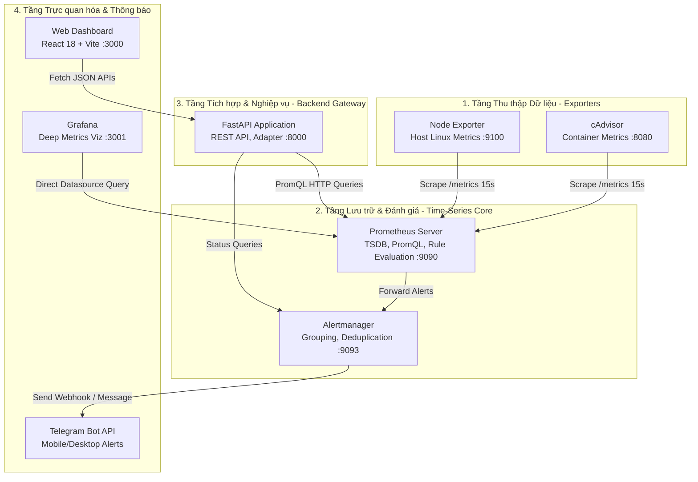

# Tài liệu Kiến trúc Hệ thống (System Architecture) — InfraWatch (N4.7)

Tài liệu này mô tả tổng thể thiết kế kiến trúc kỹ thuật của hệ thống **InfraWatch**, các quyết định thiết kế then chốt (Architectural Decision Records - ADRs) và mô hình tương tác giữa các phân hệ.

---

## 1. Mô hình Kiến trúc Phân tầng (Layered Architecture)

Kiến trúc hệ thống InfraWatch được cấu trúc thành 4 tầng chức năng rõ ràng:

---

## 2. Các Quyết định Kiến trúc Then chốt (Architectural Decision Records)

### ADR-01: Sử dụng Prometheus làm Kho lưu trữ Time-Series độc lập
- **Bối cảnh:** Cần giải pháp lưu trữ hàng triệu mẫu số liệu chuỗi thời gian từ máy chủ và container với tần suất cao.
- **Quyết định:** Sử dụng Prometheus TSDB, **không** lưu trữ time-series thô vào các hệ quản trị quan hệ (như PostgreSQL hay MySQL).
- **Lý do:** Prometheus được tối ưu hóa đặc biệt cho dữ liệu chuỗi thời gian dạng nén (Gorilla compression), cung cấp ngôn ngữ truy vấn mạnh mẽ PromQL và cơ chế pull scraping đáng tin cậy.

### ADR-02: Kiến trúc Web Dashboard trung tâm kết hợp Grafana
- **Bối cảnh:** Người dùng cần giao diện điều hành đơn giản, thân thiện, gắn liền với nhận diện thương hiệu sản phẩm, đồng thời các kỹ sư vận hành lại cần đồ thị phân tích sâu.
- **Quyết định:** Phát triển Web Dashboard độc lập bằng React 18 + FastAPI, song song duy trì Grafana như một công cụ chuyên sâu bổ trợ.
- **Lý do:** Không phụ thuộc hoàn toàn vào Grafana giúp nhóm làm chủ giao diện nghiệp vụ, dễ dàng mở rộng các tính năng tùy biến sau này.

### ADR-03: Kênh thông báo chính qua Telegram Bot API
- **Bối cảnh:** Cần kênh cảnh báo sự cố tức thời, chi phí 0 đồng, dễ dàng cài đặt trên điện thoại di động và máy tính của kỹ sư vận hành.
- **Quyết định:** Tích hợp Alertmanager với Telegram Bot API.
- **Lý do:** Telegram cung cấp API Bot ổn định, hỗ trợ định dạng HTML/Markdown phong phú, tốc độ gửi thông báo dưới 2 giây và hỗ trợ tốt thông báo theo nhóm kỹ thuật.

### ADR-04: Đóng gói và điều phối dịch vụ với Docker Compose
- **Bối cảnh:** Hệ thống cần triển khai nhanh chóng, nhất quán trên môi trường Linux VM hoặc Docker Lab của các thành viên.
- **Quyết định:** Định nghĩa toàn bộ hệ thống trong một tệp `docker-compose.yml` duy nhất với mạng nội bộ `monitoring-network`.
- **Lý do:** Giảm thiểu độ phức tạp cài đặt môi trường, đảm bảo khả năng tái tạo 100% trên bất kỳ máy chủ nào.

---

## 3. Các tài liệu kiến trúc liên quan
- Chi tiết sơ đồ ngữ cảnh: [system-context.md](file:///d:/h_Nam_4/InfraWatch/docs/architecture/system-context.md)
- Chi tiết kiến trúc container: [container-architecture.md](file:///d:/h_Nam_4/InfraWatch/docs/architecture/container-architecture.md)
- Luồng vận chuyển dữ liệu: [monitoring-data-flow.md](file:///d:/h_Nam_4/InfraWatch/docs/architecture/monitoring-data-flow.md)

