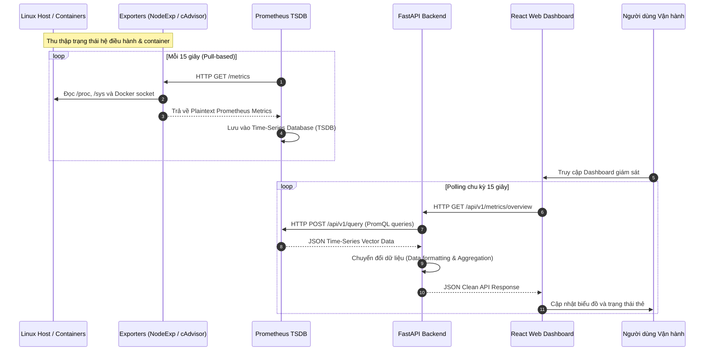
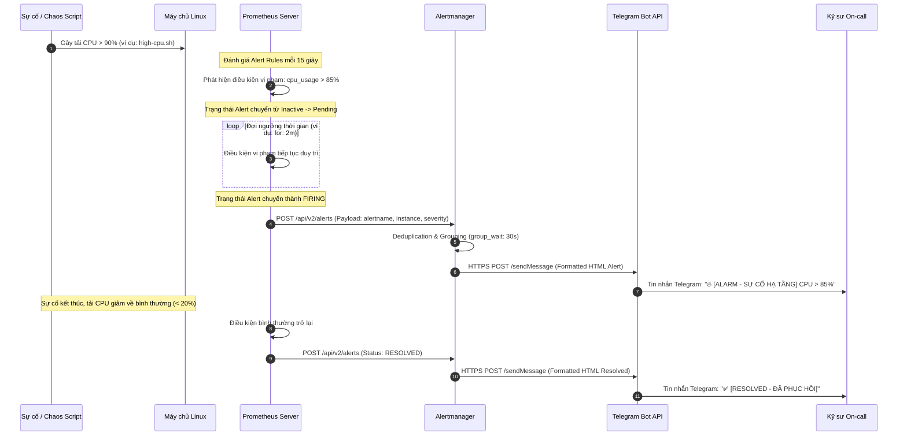

# Luồng Vận chuyển Dữ liệu Giám sát (Monitoring Data Flow) — InfraWatch (N4.7)

Tài liệu này mô tả chi tiết hai luồng dữ liệu cốt lõi trong hệ thống: **Luồng Thu thập & Trực quan hóa (Metrics Pipeline)** và **Luồng Đánh giá & Phát cảnh báo (Alerting Pipeline)**.

---

## 1. Luồng Thu thập & Trực quan hóa (Metrics Pipeline)

---

## 2. Luồng Đánh giá & Phát cảnh báo (Alerting Pipeline)

