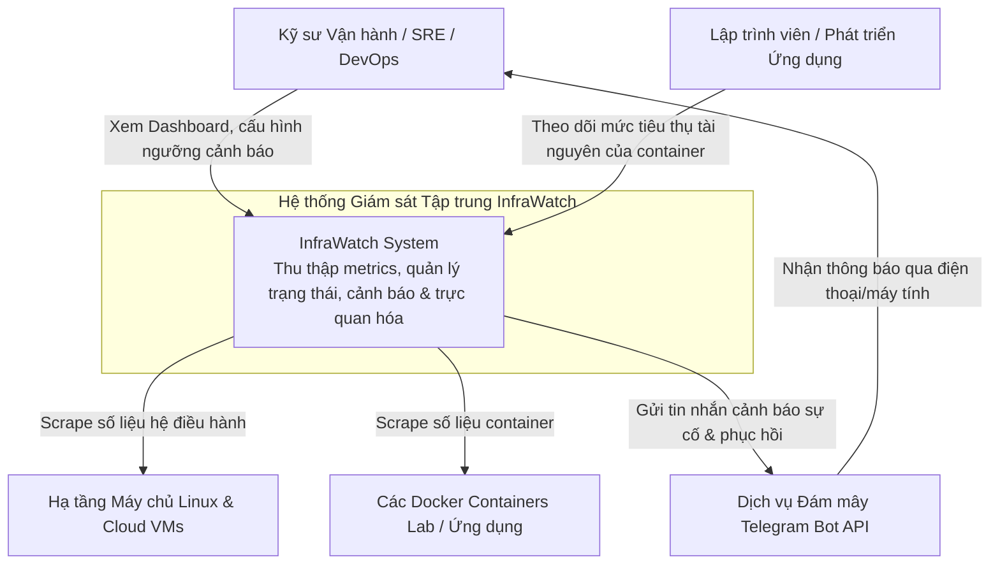

# Sơ đồ Ngữ cảnh Hệ thống (System Context - C4 Model Level 1) — InfraWatch (N4.7)

Tài liệu này mô tả vị trí của hệ thống **InfraWatch** trong môi trường vận hành tổng thể, các đối tượng người dùng tương tác và các hệ thống bên ngoài có liên quan.

---

## 1. Sơ đồ Ngữ cảnh (System Context Diagram)

---

## 2. Mô tả các Thực thể

| Thực thể | Phân loại | Vai trò & Trách nhiệm |
| :--- | :--- | :--- |
| **Kỹ sư Vận hành (DevOps/SRE)** | Người dùng chính | Giám sát trạng thái máy chủ, xử lý cảnh báo sự cố, đánh giá dung lượng hạ tầng. |
| **Lập trình viên (Developers)** | Người dùng phụ | Kiểm tra mức độ tiêu thụ CPU, RAM của các container ứng dụng để tối ưu hiệu năng. |
| **InfraWatch System** | Hệ thống phần mềm | Lõi hệ thống giám sát tập trung được xây dựng trong đồ án. |
| **Hạ tầng Linux / Cloud VMs** | Hệ thống bên ngoài | Đối tượng được giám sát: Máy chủ vật lý, máy ảo Ubuntu/Debian trong lab. |
| **Docker Containers** | Hệ thống bên ngoài | Các ứng dụng và dịch vụ đang vận hành trên máy chủ. |
| **Telegram Bot API** | Hệ thống bên ngoài | Kênh trung gian phân phối thông báo khẩn cấp tới thiết bị di động của kỹ sư. |
